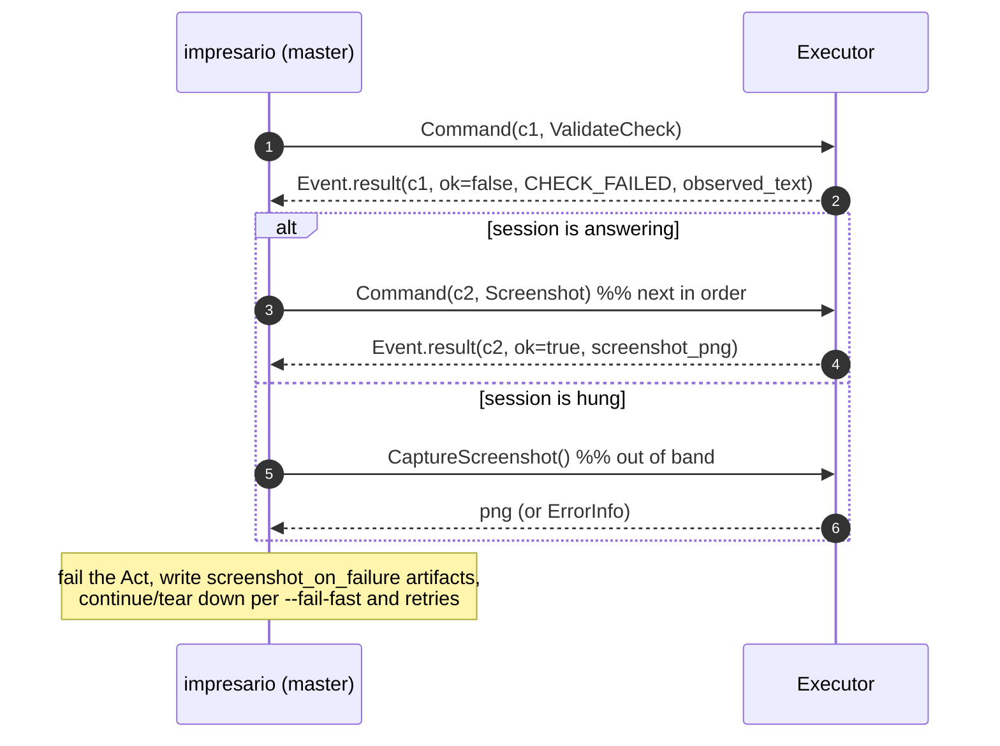
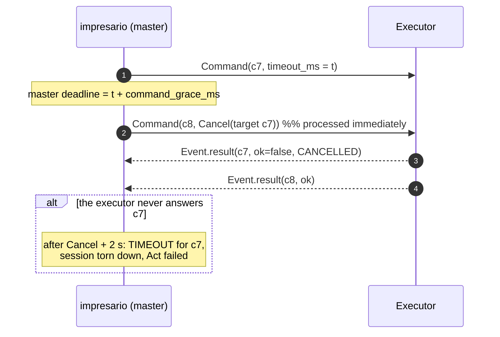

# Wire protocol

How the master and the executors actually talk. The normative contract is
`proto/impresario/v1/impresario.proto` (spec section 7.1) — this document
mirrors it, adds the sequences, and records the implementation nuances that
the test suites pin (the same rules are asserted against `MockAgent`, the
connector and the Android agent).

## 1. Service surface

```proto
service Agent {
  rpc Handshake(HandshakeRequest) returns (HandshakeResponse);
  rpc Session(stream Command) returns (stream Event);
  rpc CaptureScreenshot(ScreenshotRequest) returns (ScreenshotResponse); // out-of-band
  rpc StreamLogs(LogRequest) returns (stream LogEntry);
  rpc Shutdown(ShutdownRequest) returns (ShutdownResponse);
}
```

- `Handshake` carries `protocol_version` ("1.0.0"), `master_version`, the
  device identity, `platform`, `app_id`/`app_url` (resolved from the bound
  app's entry for that platform, or empty when the run is app-less),
  `options`, and `auth_token` when the executor is configured with a token. The answer
  carries `accepted`, `session_id`, `agent_version`, `protocol_version`,
  `capabilities`, `DeviceInfo` (runtime, OS version, screen, `tv` flag), and
  `probe_sources` (`ProbeSourceInfo { source, available, class, reason,
  external_access }`). `probe_sources` lets the master know before running
  whether a claim is reachable; it is not a verdict.
- `Session` is one bidirectional stream: the master sends `Command`s
  (`RunAction`, `ValidateCheck`, `Probe`, `KeyPress`, `Screenshot`,
  `AppControl`, `Cancel`); the executor sends `Event`s (`CommandResult`,
  `Heartbeat`, `SessionClosed`).
- `CaptureScreenshot` exists for failure capture when the session is hung;
  it may overlap an in-flight command and must not disturb it.
- `StreamLogs` streams executor-origin log lines (`source`: `agent`,
  `console`, ...). Host-side collectors (adb logcat, iOS syslog) are run by
  the master transports, not through this RPC.
- `Shutdown` ends the executor side of the run (`terminate_app` optionally
  kills the app under test). It is safe to call repeatedly.

## 2. Sequence: one run against one device

```mermaid
sequenceDiagram
    autonumber
    participant M as impresario (master)
    participant T as DeviceTransport
    participant E as Executor (connector / Android agent)

    M->>T: prepare(device)
    Note over T: connector: dial, or spawn `impresario-connector serve`<br/>adb: network dial (I-62), else adb forward + install + am instrument
    T-->>M: Endpoint(host:port)
    M->>E: connect (backoff 200 ms → 2 s, until agent_start_timeout_ms)
    M->>E: Handshake(protocol_version, platform, auth_token…)
    E-->>M: accepted, session_id, capabilities, DeviceInfo
    M->>E: Session stream open (x-impresario-session-id[, x-impresario-token])
    M-)E: StreamLogs (best effort, lazily; I-74)
    loop every step of the play
        M->>E: Command(command_id, timeout_ms, body)
        E-->>M: Event.result(command_id, ok, duration_ms, error?, observed…)
    end
    E-->>M: Heartbeat every 5 s
    M->>E: Shutdown
    M->>T: teardown() (kill children, adb forward --remove, …)
```

## 3. Sequence: a failing step and its capture



## 4. Sequence: timeout and cancel



Executors should answer `TIMEOUT` themselves before the master's deadline;
the master's cancel-then-grace path is the backstop. A `Cancel` naming an
unknown command id is a `PROTOCOL` error result *for the cancel command
itself* (spec 7.2.5).

## 5. Rules (spec 7.2, as implemented)

1. **Session identity.** `Handshake` returns `session_id`. Every later RPC
   must carry gRPC metadata `x-impresario-session-id`; with a configured
   token every RPC also needs `x-impresario-token`. Missing or invalid →
   `UNAUTHENTICATED` (`require_token` in `MockAgent` is the reference).
2. **Compatibility.** Major versions must match, else `accepted = false`
   with `PROTOCOL`. A newer master must not use features outside the
   reported `capabilities` (the master checks `AppControl`, `Logs`,
   `Screenshot` before relying on them).
3. **Single-session executors.** Native agents reject a second `Handshake`
   while a session is active with `ALREADY_IN_USE`.
4. **Ordering.** Commands on a `Session` are executed strictly in order,
   one at a time. Exactly one `CommandResult` per command, same
   `command_id`, in command order — including failures and cancellations.
5. **Cancel.** Processed immediately, even while another command runs. The
   target command finishes as soon as practical with `CANCELLED`.
6. **No crash on bad input.** Executors never close the stream because of a
   bad command: they answer `ok = false` with `ErrorInfo`. Unknown oneof
   bodies → `UNSUPPORTED_ACTION`; unspecified enums → `PROTOCOL`.
7. **Deadlines.** `timeout_ms` is the executor's wait budget for
   elements/conditions. The master enforces `timeout_ms +
   command_grace_ms`; on overrun it sends `Cancel`, waits 2 s, then fails
   the step with `TIMEOUT` and tears the session down.
8. **Heartbeat.** Executors emit `Heartbeat` every 5 s. Three missed
   heartbeats (15 s) are a `TRANSPORT` failure; there is no resume (D-12) —
   the master reconnects (handshake + new session) for later acts, as the
   dropped-stream tests show.
9. **Screenshots.** In-order screenshots use the `Screenshot` command;
   `CaptureScreenshot` is the out-of-band fallback for hung sessions.
10. **Logs.** `StreamLogs` carries executor-origin lines only; host-side
    collectors (adb logcat in `AdbTransport`, connector child stderr) run
    independently of it.
11. **Limits.** gRPC message size cap 16 MiB in both directions
    (screenshots). HTTP/2 keepalive 10 s interval, 20 s timeout.
12. **Text safety.** `text` fields are UTF-8. Executors never log
    `RunAction.text` at INFO or above; the master redacts configured
    secrets from every artifact.
13. **Probes.** A probe is one `Probe` command with `kind = SHOWING |
    PLAYER | DRM`, a selector, claims, `with` assertions, `window_ms`,
    `min_confidence` and the step timeout. The executor answers
    `CommandResult.probe = ProbeResult { verdicts, evidence,
    confidence_reached, unverifiable_reason, observed, window_ms }`.
    Reachable probes answer `ok = true` even when a claim is
    `UNVERIFIABLE`; selector/protocol failures remain normal errors. The
    master validates every evidence source/class/observation, recomputes
    the verdict with `impresario-core::probe`, and ignores the executor's
    provisional verdicts. `UNVERIFIABLE` is applied through
    `unverifiable_policy` (`fail` default, `warn` opt-in) and maps to
    `ErrorCode.UNVERIFIABLE` only when the policy fails the step.

## 6. Error codes

`ErrorInfo { code, message, details }` — codes from the proto `ErrorCode`
enum; the master keeps them verbatim in `report.json` and maps them to exit
codes as noted.

| Code | Meaning | Typically raised by | Master handling |
|---|---|---|---|
| `ELEMENT_NOT_FOUND` | selector matched nothing within the budget | executor | step failed (exit 1) |
| `TIMEOUT` | element/condition wait budget exhausted | executor (preferred) or master backstop | step failed |
| `NOT_INTERACTABLE` | element present but obscured/not hit-testable/uneditable | executor | step failed |
| `STALE_ELEMENT` | the element identity changed under automation | executor | step failed |
| `FOCUS_UNREACHABLE` | TV D-pad traversal failed (`details.focus_trail`, `details.reason`) | executor | step failed |
| `UNSUPPORTED_ACTION` | action/check/key not available on this platform | executor (planner normally rejects first with `IMP-DSL-013`) | infra error (exit 3) |
| `INVALID_SELECTOR` | selector cannot be served at runtime | executor | step failed |
| `CHECK_FAILED` | check evaluated false; `observed_text`/`observed_count` carry evidence | executor | step failed |
| `UNVERIFIABLE` | probe evidence cannot establish either side at the required confidence | master after re-evaluation | `unverifiable` step; failed under `fail` policy, warning under `warn` |
| `APP_CRASHED` | app under test died | executor | step failed, run aborts that device |
| `CANCELLED` | the command was cancelled | executor (per `Cancel`) | folded into the timeout path |
| `TRANSPORT` | connection lost, handshake timeout, missed heartbeats | either side | infra error (exit 3) |
| `PROTOCOL` | malformed frame, unspecified enum, version mismatch, bad cancel id | either side | infra error (exit 3) |
| `INTERNAL` | executor bug; `details` carry context | executor | infra error (exit 3) |
| `ALREADY_IN_USE` | second handshake on a single-session executor | executor | infra error (exit 3) |
| `DEVICE_UNAVAILABLE` | transport cannot prepare/reach the device | master transport | infra error (exit 3) |
| `UNAUTHENTICATED` | missing/invalid `auth_token`/`x-impresario-token` | executor | infra error (exit 3) |

Config/DSL problems are reported *before* any wire traffic as `IMP-*`
diagnostics (exit 2). Ctrl-C stops the run with exit 130.

## 7. How the executor endpoint is reached

| Family | Default endpoint | Path |
|---|---|---|
| connector (`web`, `webos`, `tizen`) | `127.0.0.1:50051` | `options.connector_address` if set; a live listener is dialed directly, otherwise the master spawns `impresario-connector serve --listen <addr>` |
| adb (`android`, `androidtv`) | `127.0.0.1:<auto forwarded>` | network dial first: `connection.endpoint` → the serial's host (`adb` `ip route` learns the Wi-Fi IP) → `adb forward` fallback; then install the APKs in order and start `am instrument` (I-62) |
| apple (`ios`, `tvos`) | tvOS: `connection.endpoint` required | `iproxy` + `xcodebuild test-without-building` runner (spec 9.3; the macOS path is a recorded D-19 gap) |

Dialing retries with exponential backoff (200 ms → 2 s) until
`agent_start_timeout_ms`. `device check` (alias `devices check`) runs prepare +
`Handshake` + teardown and prints the `DeviceInfo` line without opening a
session.

## 8. Implementation notes pinned by tests

- **Lazy `StreamLogs` (I-74).** A tonic streaming call is not "open" until
  the response headers arrive, and an executor may delay them. The master
  therefore opens `StreamLogs` in the background *after* the session
  handshake; commands flow even if the log stream's headers are late, and a
  missing/erroring log stream never fails the run.
- **Secrets never cross artifacts.** The token travels in handshake and
  metadata only; log lines and reports are redacted (`PLAY_SECRET` covers
  both directions in the tests).
- **Capability gating.** `app` actions require `AppControl`; failure
  screenshots require `Screenshot`; the log stream requires `Logs`. A
  missing capability degrades gracefully or errors — it never hangs
  (covered by the capability-gap scenarios).
- **The `MockAgent` is the reference implementation of these rules** and is
  what `cargo test --workspace` exercises; the connector fixture suite and
  the on-device Android wire tests check the real executors against the same
  sequences.
